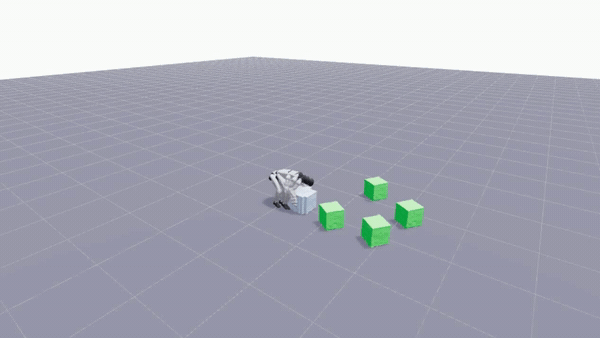
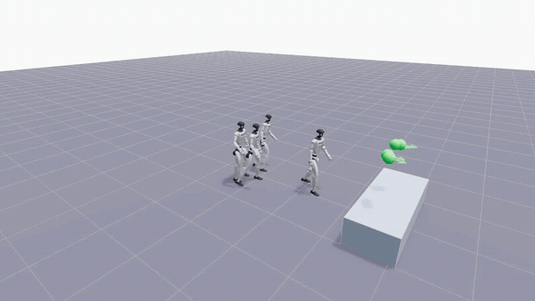

# Hybrid Motion Imitation

<table>
  <tr>
    <td align="center" width="50%">
      <strong>Box Moving</strong><br>
      
    </td>
    <td align="center" width="50%">
      <strong>Box Climbing</strong><br>
      
    </td>
  </tr>
</table>

This is an unofficial implementation and extension of
[GfR](https://jiashunwang.github.io/GfR/) and
[HIL](https://jiashunwang.github.io/HIL/), built on top of
[Holosoma](https://github.com/amazon-far/holosoma). It is not the official
code release for either paper.

This release provides two tasks for the
29-DoF Unitree G1:

```text
exp:g1-29dof-wbt-hybrid-climb
exp:g1-29dof-wbt-hybrid-object
```

The same hybrid learning framework is used for both box climbing and box
moving. Its key ideas are:

1. **The actor does not observe the target reference motion.** We find that this
   design can achieve high-quality motion tracking across a wide range of
   tasks; see the [HIL paper](https://jiashunwang.github.io/HIL/) for more details.
   The actor only observes the robot state and sparse task conditions or goals,
   while the reference motion is used to define the goals and tracking rewards.
   Because the policy is conditioned on task goals rather than a reference
   motion, the learned behavior can easily transfer to new task conditions.

2. **Training combines two types of environments.**
   - In **reference-tracking environments**, goals and task conditions are extracted from the
     reference motion and the policy is trained with tracking rewards.
   - In **general RL environments**, goals and task conditions are randomized
     and the policy is trained with sparse goal-reaching rewards.

3. **One policy is jointly optimized on two types of environments.** The actor always uses the
   same observation interface across track and general RL envs, while the critic receives task-specific privileged information. This allows behavior learned from a small reference set to generalize to a wide range of task conditions and goals.

## Setup

Run from the repository root:

```bash
bash scripts/setup_isaacsim.sh
source scripts/source_isaacsim_setup.sh
wandb login
```

## Training

Training uses two stages:

1. Stage 1 trains track environments only.
2. Stage 2 resumes Stage 1 and trains a 50/50 mix of track and gen
   environments.

### Climb Stage 1

```bash
CUDA_VISIBLE_DEVICES=0 \
python src/holosoma/holosoma/train_agent.py \
  exp:g1-29dof-wbt-hybrid-climb \
  logger:wandb \
  --training.num-envs=8192 \
  --algo.config.num-learning-iterations=15000 \
  --simulator.config.scene.env-spacing=5.0 \
  --command.setup-terms.motion-command.params.motion-config.hybrid.track-ratio=1.0 \
  --command.setup-terms.motion-command.params.motion-config.motion-dir='holosoma/data/motions/g1_29dof/whole_body_tracking/climbox1' \
  --command.setup-terms.motion-command.params.motion-config.start-at-timestep-zero-prob=0.05 \
  --command.setup-terms.motion-command.params.motion-config.goal-orientation.robot-yaw-only=True \
  --command.setup-terms.motion-command.params.motion-config.hybrid.size-randomization.enabled=False
```

### Climb Stage 2

Replace `CLIMB_STAGE1_CHECKPOINT` with the Stage 1 `model.pt`.

```bash
CUDA_VISIBLE_DEVICES=0 \
python src/holosoma/holosoma/train_agent.py \
  exp:g1-29dof-wbt-hybrid-climb \
  logger:wandb \
  --training.checkpoint=CLIMB_STAGE1_CHECKPOINT \
  --training.num-envs=8192 \
  --algo.config.num-learning-iterations=15000 \
  --algo.config.reset-policy-std-on-resume=True \
  --algo.config.init-noise-std=0.45 \
  --simulator.config.scene.env-spacing=5.0 \
  --command.setup-terms.motion-command.params.motion-config.hybrid.track-ratio=0.5 \
  --command.setup-terms.motion-command.params.motion-config.motion-dir='holosoma/data/motions/g1_29dof/whole_body_tracking/climbox1' \
  --command.setup-terms.motion-command.params.motion-config.start-at-timestep-zero-prob=0.05 \
  --command.setup-terms.motion-command.params.motion-config.goal-orientation.robot-yaw-only=True \
  --command.setup-terms.motion-command.params.motion-config.hybrid.gen-start-at-timestep-zero-prob=0.2 \
  --command.setup-terms.motion-command.params.motion-config.hybrid.gen-step-zero-root-noise.pos-std-xyz='[0.3, 0.3, 0.01]' \
  --command.setup-terms.motion-command.params.motion-config.hybrid.gen-step-zero-root-noise.pos-clip-xyz='[1.0, 1.0, 0.02]' \
  --command.setup-terms.motion-command.params.motion-config.hybrid.gen-step-zero-root-noise.rpy-std='[0.05, 0.05, 0.3]' \
  --command.setup-terms.motion-command.params.motion-config.hybrid.gen-step-zero-root-noise.rpy-clip='[0.15, 0.15, 1.0]' \
  --command.setup-terms.motion-command.params.motion-config.hybrid.size-randomization.enabled=False
```

### Object Stage 1

```bash
CUDA_VISIBLE_DEVICES=0 \
python src/holosoma/holosoma/train_agent.py \
  exp:g1-29dof-wbt-hybrid-object \
  logger:wandb \
  --training.num-envs=8192 \
  --algo.config.num-learning-iterations=15000 \
  --simulator.config.scene.env-spacing=4.0 \
  --command.setup-terms.motion-command.params.motion-config.hybrid.track-ratio=1.0 \
  --command.setup-terms.motion-command.params.motion-config.motion-dir='holosoma/data/motions/g1_29dof/whole_body_tracking/movebox' \
  --command.setup-terms.motion-command.params.motion-config.start-at-timestep-zero-prob=0.05 \
  --command.setup-terms.motion-command.params.motion-config.hybrid.size-randomization.enabled=False
```

### Object Stage 2

Replace `OBJECT_STAGE1_CHECKPOINT` with the Stage 1 `model.pt`.

```bash
CUDA_VISIBLE_DEVICES=0 \
python src/holosoma/holosoma/train_agent.py \
  exp:g1-29dof-wbt-hybrid-object \
  logger:wandb \
  --training.checkpoint=OBJECT_STAGE1_CHECKPOINT \
  --training.num-envs=8192 \
  --algo.config.num-learning-iterations=15000 \
  --algo.config.reset-policy-std-on-resume=True \
  --algo.config.init-noise-std=0.45 \
  --simulator.config.scene.env-spacing=4.0 \
  --command.setup-terms.motion-command.params.motion-config.hybrid.track-ratio=0.5 \
  --command.setup-terms.motion-command.params.motion-config.motion-dir='holosoma/data/motions/g1_29dof/whole_body_tracking/movebox' \
  --command.setup-terms.motion-command.params.motion-config.start-at-timestep-zero-prob=0.05 \
  --command.setup-terms.motion-command.params.motion-config.hybrid.gen-start-at-timestep-zero-prob=0.2 \
  --command.setup-terms.motion-command.params.motion-config.hybrid.object-goal-noise.pos-std-xyz='[0.5, 0.5, 0.001]' \
  --command.setup-terms.motion-command.params.motion-config.hybrid.object-goal-noise.pos-clip-xyz='[1.0, 1.0, 0.001]' \
  --command.setup-terms.motion-command.params.motion-config.hybrid.object-goal-noise.rpy-std='[0.001, 0.001, 0.4]' \
  --command.setup-terms.motion-command.params.motion-config.hybrid.object-goal-noise.rpy-clip='[0.001, 0.001, 0.8]' \
  --curriculum.setup-terms.hybrid-gen-noise-curriculum.params.enabled=True \
  --curriculum.setup-terms.hybrid-gen-noise-curriculum.params.initial-scale=0.3 \
  --termination.terms.bad-tracking.params.gen-bad-object-pos-z-threshold=0.6 \
  --command.setup-terms.motion-command.params.motion-config.hybrid.size-randomization.enabled=False
```

The same commands are available in
[`scripts_run/run_train.sh`](scripts_run/run_train.sh).


## Evaluation

We use Viser for web-based visualization. Training and evaluation can run
headlessly on a remote server, while the simulation is viewed from any machine
with a web browser—no local workstation or Isaac Sim window is required. The
examples serve Viser at `http://localhost:8012`.

### Climb Stage 1: track

```bash
CUDA_VISIBLE_DEVICES=0 \
python src/holosoma/holosoma/eval_agent.py \
  --checkpoint=CLIMB_STAGE1_CHECKPOINT \
  --viser.config.enabled \
  --viser.config.port=8012 \
  --training.num-envs=2 \
  --training.headless=True \
  --training.max-eval-steps=10000 \
  --training.export-onnx=False \
  --simulator.config.scene.env-spacing=5.0 \
  --command.setup-terms.motion-command.params.motion-config.hybrid.track-ratio=1.0 \
  --command.setup-terms.motion-command.params.motion-config.motion-file='' \
  --command.setup-terms.motion-command.params.motion-config.motion-dir='holosoma/data/motions/g1_29dof/whole_body_tracking/climbox1' \
  --command.setup-terms.motion-command.params.motion-config.eval-sample-random-timestep=False \
  --command.setup-terms.motion-command.params.motion-config.goal-orientation.robot-yaw-only=True \
  --termination.terms.body-proximity.func='holosoma.managers.termination.terms.common:timeout_exceeded' \
  --termination.terms.body-proximity.is-timeout=True \
  --termination.terms.bad-tracking.func='holosoma.managers.termination.terms.common:timeout_exceeded' \
  --termination.terms.bad-tracking.is-timeout=True \
  --command.setup-terms.motion-command.params.motion-config.hybrid.size-randomization.enabled=False
```

### Climb Stage 2: gen

```bash
CUDA_VISIBLE_DEVICES=0 \
python src/holosoma/holosoma/eval_agent.py \
  --checkpoint=CLIMB_STAGE2_CHECKPOINT \
  --viser.config.enabled \
  --viser.config.port=8012 \
  --viser.config.no-show-reference \
  --training.num-envs=2 \
  --training.headless=True \
  --training.max-eval-steps=10000 \
  --training.export-onnx=False \
  --simulator.config.scene.env-spacing=0.0 \
  --command.setup-terms.motion-command.params.motion-config.hybrid.track-ratio=0.0 \
  --command.setup-terms.motion-command.params.motion-config.motion-file='' \
  --command.setup-terms.motion-command.params.motion-config.motion-dir='holosoma/data/motions/g1_29dof/whole_body_tracking/climbox1' \
  --command.setup-terms.motion-command.params.motion-config.eval-sample-random-timestep=False \
  --command.setup-terms.motion-command.params.motion-config.goal-orientation.robot-yaw-only=True \
  --command.setup-terms.motion-command.params.motion-config.hybrid.gen-step-zero-root-noise.pos-std-xyz='[0.3, 0.3, 0.01]' \
  --command.setup-terms.motion-command.params.motion-config.hybrid.gen-step-zero-root-noise.pos-clip-xyz='[1.0, 1.0, 0.02]' \
  --command.setup-terms.motion-command.params.motion-config.hybrid.gen-step-zero-root-noise.rpy-std='[0.05, 0.05, 0.3]' \
  --command.setup-terms.motion-command.params.motion-config.hybrid.gen-step-zero-root-noise.rpy-clip='[0.15, 0.15, 1.0]' \
  --termination.terms.body-proximity.func='holosoma.managers.termination.terms.common:timeout_exceeded' \
  --termination.terms.body-proximity.is-timeout=True \
  --termination.terms.bad-tracking.func='holosoma.managers.termination.terms.common:timeout_exceeded' \
  --termination.terms.bad-tracking.is-timeout=True \
  --command.setup-terms.motion-command.params.motion-config.hybrid.size-randomization.enabled=False
```

### Object Stage 1: track

```bash
CUDA_VISIBLE_DEVICES=0 \
python src/holosoma/holosoma/eval_agent.py \
  --checkpoint=OBJECT_STAGE1_CHECKPOINT \
  --viser.config.enabled \
  --viser.config.port=8012 \
  --training.num-envs=2 \
  --training.headless=True \
  --training.max-eval-steps=10000 \
  --training.export-onnx=False \
  --simulator.config.scene.env-spacing=0.0 \
  --command.setup-terms.motion-command.params.motion-config.hybrid.track-ratio=1.0 \
  --command.setup-terms.motion-command.params.motion-config.motion-file='' \
  --command.setup-terms.motion-command.params.motion-config.motion-dir='holosoma/data/motions/g1_29dof/whole_body_tracking/movebox' \
  --command.setup-terms.motion-command.params.motion-config.eval-sample-random-timestep=False \
  --command.setup-terms.motion-command.params.motion-config.hybrid.size-randomization.enabled=False \
  --termination.terms.bad-tracking.func='holosoma.managers.termination.terms.common:timeout_exceeded' \
  --termination.terms.bad-tracking.is-timeout=True \
  --termination.terms.body-proximity.func='holosoma.managers.termination.terms.common:timeout_exceeded' \
  --termination.terms.body-proximity.is-timeout=True
```

### Object Stage 2: gen

```bash
CUDA_VISIBLE_DEVICES=0 \
python src/holosoma/holosoma/eval_agent.py \
  --checkpoint=OBJECT_STAGE2_CHECKPOINT \
  --viser.config.enabled \
  --viser.config.port=8012 \
  --viser.config.no-show-reference \
  --training.num-envs=2 \
  --training.headless=True \
  --training.max-eval-steps=10000 \
  --training.export-onnx=False \
  --simulator.config.scene.env-spacing=0.0 \
  --command.setup-terms.motion-command.params.motion-config.hybrid.track-ratio=0.0 \
  --command.setup-terms.motion-command.params.motion-config.motion-file='' \
  --command.setup-terms.motion-command.params.motion-config.motion-dir='holosoma/data/motions/g1_29dof/whole_body_tracking/movebox' \
  --command.setup-terms.motion-command.params.motion-config.eval-sample-random-timestep=False \
  --command.setup-terms.motion-command.params.motion-config.hybrid.object-goal-noise.pos-std-xyz='[0.5, 0.5, 0.001]' \
  --command.setup-terms.motion-command.params.motion-config.hybrid.object-goal-noise.pos-clip-xyz='[1.0, 1.0, 0.001]' \
  --command.setup-terms.motion-command.params.motion-config.hybrid.object-goal-noise.rpy-std='[0.001, 0.001, 0.4]' \
  --command.setup-terms.motion-command.params.motion-config.hybrid.object-goal-noise.rpy-clip='[0.001, 0.001, 0.8]' \
  --curriculum.setup-terms.hybrid-gen-noise-curriculum.params.initial-scale=1.0 \
  --termination.terms.body-proximity.func='holosoma.managers.termination.terms.common:timeout_exceeded' \
  --termination.terms.body-proximity.is-timeout=True \
  --termination.terms.bad-tracking.func='holosoma.managers.termination.terms.common:timeout_exceeded' \
  --termination.terms.bad-tracking.is-timeout=True \
  --command.setup-terms.motion-command.params.motion-config.hybrid.size-randomization.enabled=False
```

The same commands are available in
[`scripts_run/run_play.sh`](scripts_run/run_play.sh).

Important evaluation behavior:

- `training.num-envs=2` controls the simulated environment count. Viser can
  display up to 16 by default, so no separate Viser count is needed.
- `eval-sample-random-timestep=False` starts every reset at timestep zero.
  Task reset noise still applies.
- The play commands disable early failure termination for longer sessions.
- `no-show-reference` hides the displaced blue reference in gen mode.

## Hybrid method

See [docs/wbt-hybrid.md](docs/wbt-hybrid.md) for the track/gen design,
observations, rewards, reset and goal noise, curriculum, termination
conditions, and checkpoint compatibility.

## Citation

This implementation is based on the learning frameworks introduced in GfR
(RSS 2026) and HIL (ACM TOG 2026). If it is useful for your research, please
cite the two papers:

```bibtex
@inproceedings{wang2026generalizing,
  title={Generalizing from References using a Multi-Task Reference and Goal-Driven RL Framework},
  author={Wang, Jiashun and Mungai, M. Eva and Li, He and Sleiman, Jean Pierre and Hodgins, Jessica and Farshidian, Farbod},
  booktitle={Robotics: Science and Systems},
  year={2026}
}

@article{wang2026hil,
  title={{HIL:} Hybrid Imitation Learning for Dynamic Athletic Control},
  author={Wang, Jiashun and Jiang, Yifeng and Zhang, Haotian and Tessler, Chen and Rempe, Davis and Hodgins, Jessica and Peng, Xue Bin},
  journal={{ACM} Transactions on Graphics},
  year={2026}
}
```

## License

This project is licensed under the Apache License 2.0. See [LICENSE](LICENSE).

## Acknowledgements

This project is built on [Holosoma](https://github.com/amazon-far/holosoma).
